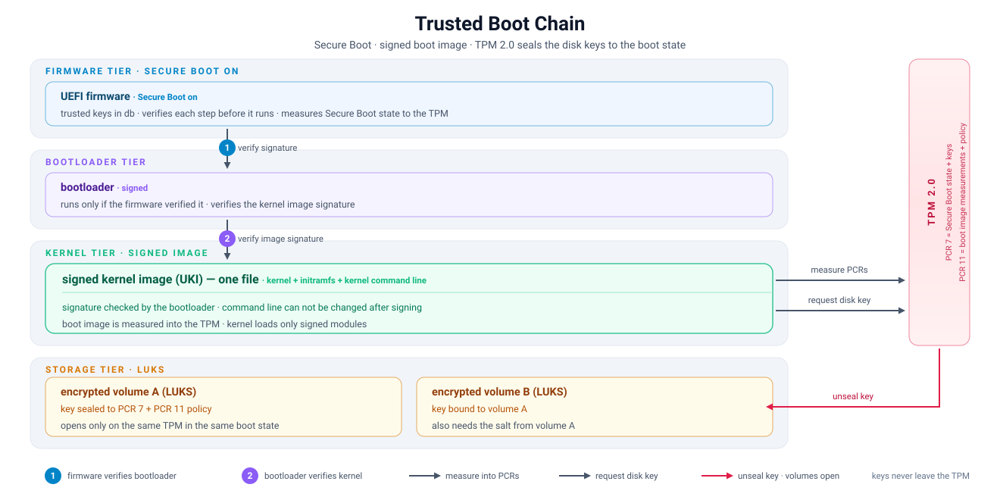

## Releases

Supported Kubernetes versions and platforms per Talos version  
cf. [support-matrix](https://docs.siderolabs.com/talos/v1.14/getting-started/support-matrix)
* Talos minor releases ship every 4 months, aligned with the Kubernetes cycle
* Each Talos minor has a **default Kubernetes** version (Talos 1.14 ships 1.37).
* Each Talos minor supports **six Kubernetes minors**, counted back from its default.
* The versions are **independent**: a Talos upgrade does not change Kubernetes.
* To raise Kubernetes past the supported range, upgrade Talos first.
* Migrations are tested only between adjacent minor versions.

# Image Factory

Image Factory documentation, source and UI:  
<https://docs.siderolabs.com/talos/v1.14/learn-more/image-factory>  
<https://github.com/siderolabs/image-factory>  
<https://factory.talos.dev>

* Frontends: HTTP download, PXE, and container registry.
* A **model** is one image. Inputs: schematic ID, Talos version, model type, architecture.
* The installer image serves install and upgrade...
  - ...carries only system extensions
  - ...kernel args and META apply only to boot media.
* Use the same **schematic** for boot media and installer image...
  - ...or the extensions change at first install.
* Built on the Talos `imager` container; all images are signed. It can also run on-premises.

Get the installer image

```bash
talosctl -n 10.5.1.2 get machineconfig -o json \
      | jq -r '.spec' \
      | yq 'select(.kind == "UnattendedInstallConfig") \
      | .installer.image'
```
```txt
factory.talos.dev/metal-installer/376567988ad370138ad8b2698212367b8edcb69b5fd68c80be1f2ec7d603b4ba:v1.14.6
```

### Assets

Five classes:

* ISO — bootable install media for install to disk.
* Kernel, initramfs, kernel command line...
  - ...components required for network boot (PXE)...
  - ...script at `pxe.factory.talos.dev` references the kernel and initramfs over HTTP.
* UKI — a Unified Kernel Image...
  - ...kernel, initramfs, and command line packed into one EFI file
  - ...for UEFI boot, especially Secure Boot.
* Disk images
  - Full disk image with Talos already installed.
  - The machine boots straight into a working Talos system.
  - For upgrades ...either build a new image or run an in-place upgrade via installer
* Installer image — installs Talos to disk (also performs upgrades)

Practical Difference

- **Boot assets** ...bare metal / PXE / fresh installs  
  cf. [platform-specific-installations/boot-assets](https://docs.siderolabs.com/talos/v1.14/platform-specific-installations/boot-assets)
- Disk images ...cloud providers (AWS AMI), VMs where you want ready-made images.
- System extensions can be baked into either, or just into the `installer` image.

### Schematic

* A **schematic** is a small YAML file with the customizations of a Talos image:
  - `systemExtensions`,
  - `extraKernelArgs`,
  - `meta` values
  - `overlay` (for single board computers)

A **schematic ID** is a deterministic hash of an image

* It is **content-addressable**: the ID is a hash of the content.
  - The same file always gives the same ID.
  - The vanilla schematic has ID `3765...b4ba`.

# System Extensions

System Extensions — extend the Talos root filesystem  
cf. [build-and-extend-talos/custom-images-and-development/system-extensions](https://docs.siderolabs.com/talos/v1.14/build-and-extend-talos/custom-images-and-development/system-extensions)

* Add files (drivers, container runtimes, firmware) to Talos's immutable root filesystem...
* ...only activated during the installation or upgrade of Talos Linux
* Official Tiers cf. [siderolabs/extensions](https://github.com/siderolabs/extensions)
  - `core`: fully supported by Sidero Labs
  - `extra`: best-effort support, still updated by Sidero Labs
  - `contrib`: community supported, disabled if build fails
* Use Image Factory to build boot assets...
  - ...depending on the extension include in both initial boot assets and disk images

[custom-images-and-development/building-a-system-extension](https://docs.siderolabs.com/talos/v1.14/build-and-extend-talos/custom-images-and-development/building-a-system-extension)

# Secure Boot

**Threats it blocks**

- Tampered boot path from attackers with physical or firmware access.
- Stolen disks open only on its own TPM in the same boot state.
- Prevents silent rollback or swap to a different Linux kernel.
- Prevents changes to the kernel command line (PCR 11.

**TPM** (Trusted Platform Module)

- Small hardware chip on the board that stores cryptographic keys
  - Keys can be generated inside the chip and never leave it in usable form.
  - TPM 2.0 is the current spec ...adds PCR policies
- **PCRs** (Platform Configuration Registers)
  - Numbered values (PCR 0–23) that the firmware and bootloader extend...
  - ...with measurements of every boot step.
  - A PCR value is a fingerprint of the boot path.
- Software can seal (encrypt) a key to PCR values
  - The TPM decrypts it only when those PCRs still match.
  - That is how Talos hides the LUKS disk keys.

## Boot Chain



- UEFI firmware
  - Must support Secure Boot and populate PCR 7
  - Sidero Labs secure boot public key (and its certificate)
  - PCR 7 measures the Secure Boot state and the keys in the firmware.
- Bootloader
  - `systemd-boot` signed
  - Firmware checks its signature before running it.
- Signed kernel image (UKI)
  - One signed file with kernel, initramfs, and kernel command line.
  - The command line cannot be changed later.
  - PCR 11 measures the signed UKI (kernel, initramfs, command line).

## Firmware

Firmware and systemd-boot measure each step into TPM PCRs.

- **PCR 7** holds the Secure Boot state and keys.
- **PCR 11** holds UKI measurements.
  - Talos matches them against a policy signed by Sidero Labs.
  - The TPM unseals the STATE and EPHEMERAL (LUKS2) keys only when both match

# Upgrade

Talos keeps two OS images (A/B slots)  
[lifecycle-management/upgrading-talos](https://docs.siderolabs.com/talos/v1.14/configure-your-talos-cluster/lifecycle-management/upgrading-talos)

* ...failed upgrade can revert to a previous image
* **How it works**
  - The previous kernel and OS image are kept after each upgrade.
  - If the new image cannot boot, the bootloader automatically falls back.
  - `talosctl rollback` updates the boot reference and reboots.
