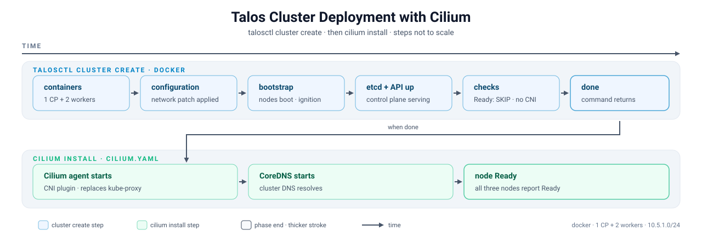

# Deployment



Set environment variable before deployment:

```bash
talos_version=$(talosctl version --client | awk '/Tag:/ {print $2; exit}')
cilium_version="$(cilium version --client | sed -n 's/^cilium image (stable): v\([0-9][0-9.]*\)$/\1/p')"
export TALOSCONFIG="$PWD/.talos/talosconfig"
export KUBECONFIG="$PWD/.talos/kubeconfig"
```

Create the cluster, and set the endpoint

```bash
talosctl cluster create docker \
  --name gamma --subnet "10.5.1.0/24" --workers 2 \
  --state "$PWD/.talos/clusters" \
  --talosconfig-destination "$TALOSCONFIG" \
  --image "ghcr.io/siderolabs/talos:$talos_version" \
  --config-patch-controlplanes=@talos-network.yaml
# Without no CNI, the kubelet reports NotReady

# configure the control plane endpoint
talosctl config node 10.5.1.2

# (later) tear down this experiment
talosctl cluster destroy --name gamma --state "$PWD/.talos/clusters"
rm -rf "$PWD/.talos"
```


**Install the Cilium CNI plugin**

```bash
cilium install --version "$cilium_version" --values cilium.yaml
# wait until Cilium is installed
cilium status --wait
```


# Configuration

## Talos

Patches deletes Flannel CNI plugin and disables `kube-proxy` (both replaced by Cilium)

```yaml
# talos-network.yaml
apiVersion: v1alpha1
kind: KubeFlannelCNIConfig
$patch: delete
---
apiVersion: v1alpha1
kind: KubeProxyConfig
enabled: false
```
- `KubeFlannelCNIConfig` — removes the default Flannel CNI
- `patch: delete` — JSON6902 marker; Talos deletes this resource
- `KubeProxyConfig` with `enabled: false` — disables `kube-proxy`

There should be no information about Flannel (CNI):

```bash
talosctl get machineconfig v1alpha1 -o jsonpath='{.spec}' \
      | yq -N '.kind // "(v1alpha1)"' | grep -c Flannel
```

**`kube-proxy` is disabled**

```bash
talosctl get machineconfig v1alpha1 -o jsonpath='{.spec}' \
      | yq 'select(.kind == "KubeProxyConfig")'
```
```txt
apiVersion: v1alpha1
kind: KubeProxyConfig
enabled: false # Enable or disable kube-proxy deployment on cluster bootstrap.
image: registry.k8s.io/kube-proxy:v1.37.1 # The container image used in the kube-proxy manifest.
# Provide configuration for the kube-proxy.
config: {}
```

**KubePrism configuration**

```bash
talosctl -n 10.5.1.3 get kubeprismstatuses
```
```txt
NODE       NAMESPACE   TYPE              ID                 VERSION   HOST             HEALTHY
10.5.1.3   k8s         KubePrismStatus   k8s-loadbalancer   3         127.0.0.1:7445   true
```
- Cilium is the CNI and service load balancer here...
- ...KubePrism is its per-node local proxy to the API servers.
  - One KubePrism pod runs on every node
  - Listens on `localhost:7445` (`k8sServiceHost` / `k8sServicePort` in `cilium.yaml`)
  - Balances each request across the control plane API servers
  - Local tools (kubelet, kubectl) reach the API via loopback

## Cilium

**Cilium (CNI) works as service load balancer**

- Assigns pod IPs from `node.spec.podCIDR` (IPAM mode kubernetes)
- Implements ClusterIP, NodePort, ExternalIPs directly in eBPF
- No iptables rules: service routing lives in eBPF maps
- Pod identity and network policy come from the same eBPF data

`cilium-cli` does not auto-detect Talos and requires following configuration:

```yaml
ipam:
  mode: kubernetes
kubeProxyReplacement: true
k8sServiceHost: localhost
k8sServicePort: 7445
cgroup:
  autoMount:
    enabled: false
    hostRoot: /sys/fs/cgroup
securityContext:
  capabilities:
    ciliumAgent: [CHOWN, KILL, NET_ADMIN, NET_RAW, IPC_LOCK, SYS_ADMIN, SYS_RESOURCE, DAC_OVERRIDE, FOWNER, SETGID, SETUID]
    cleanCiliumState: [NET_ADMIN, SYS_ADMIN, SYS_RESOURCE]
```

**Why these settings in `cilium.yaml`**

- `kubeProxyReplacement: true` pairs with `KubeProxyConfig.enabled: false`
- `cgroup.autoMount` off: Talos mounts cgroup v2 itself
- `SYS_MODULE` dropped: Talos blocks pod kernel module loading
- `ipam.mode: kubernetes` reuses Talos's `KubeNetworkConfig` pod CIDR

Examine the network configuration:

```bash
kubectl -n kube-system exec ds/cilium \
      -- cilium-dbg status | grep -E 'KubeProxyReplacement|Routing|Kubernetes:'
```
```txt
Kubernetes:              Ok         1.37 (v1.37.1) [linux/amd64]
KubeProxyReplacement:    True   [eth0  10.5.1.4 (Direct Routing)]
Routing:                 Network: Tunnel [vxlan]   Host: Legacy
```

# Experiments